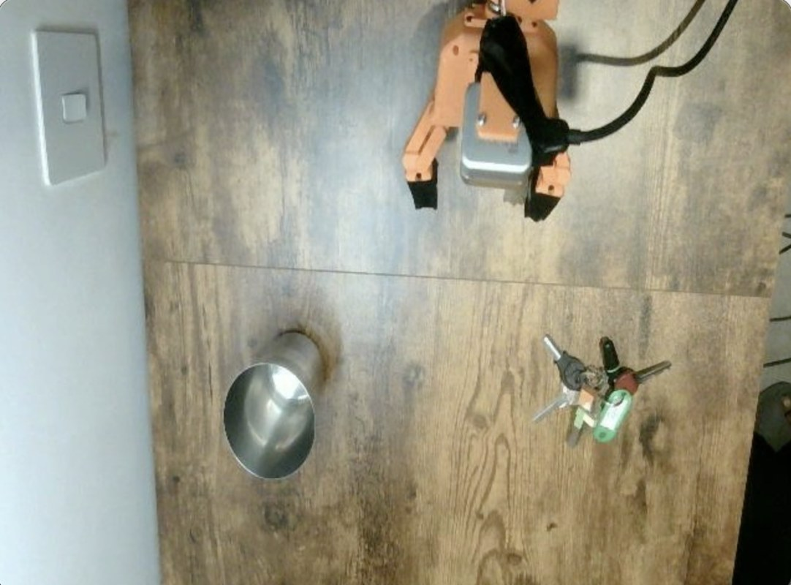
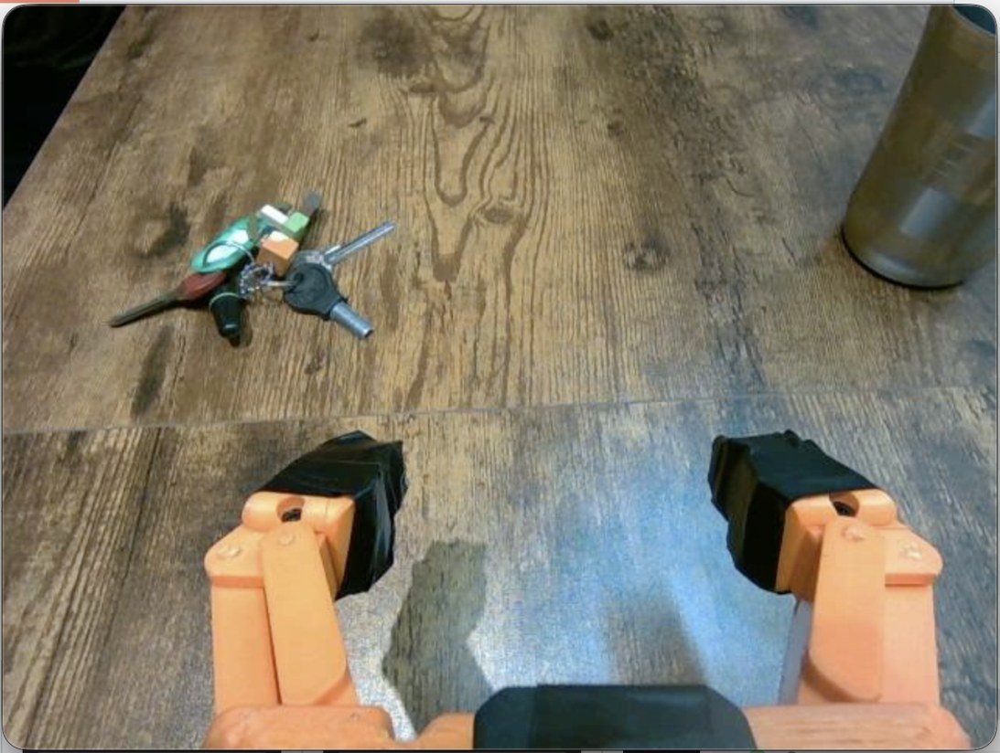
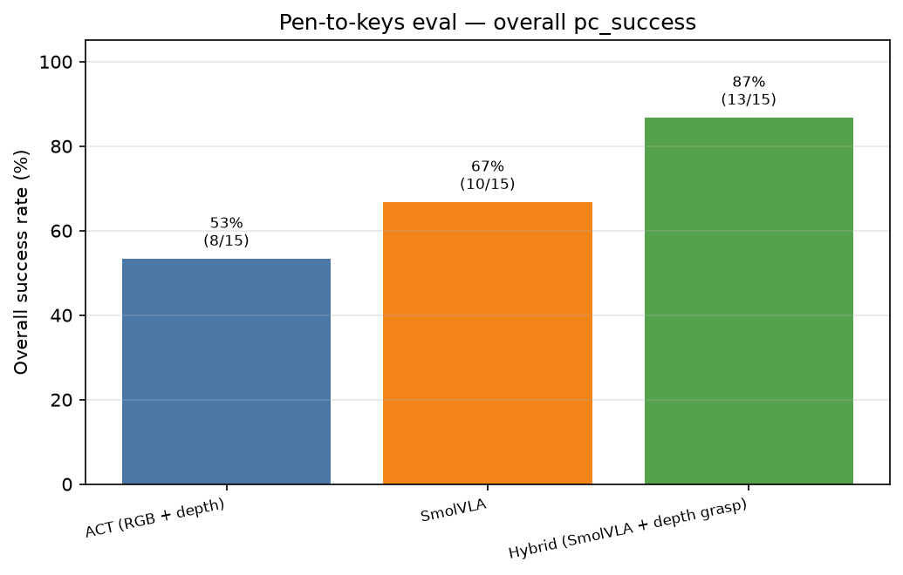
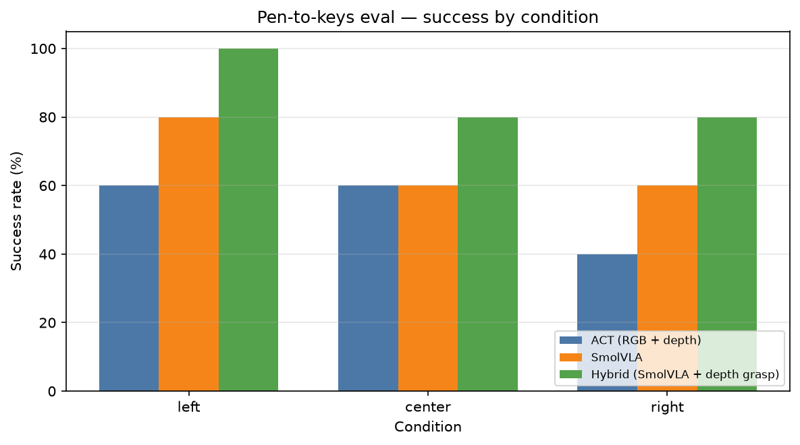
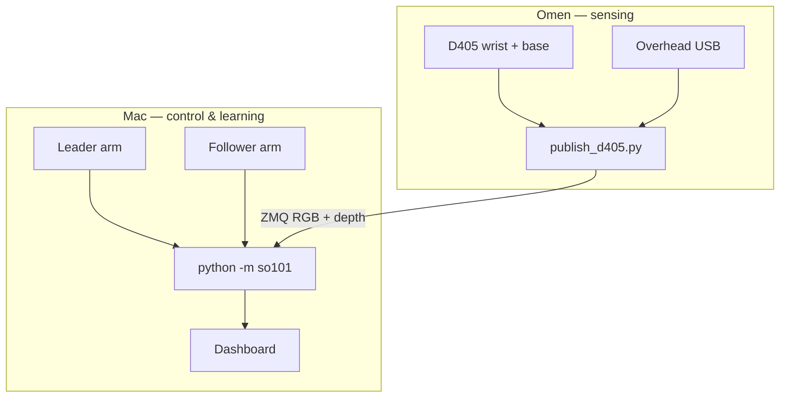
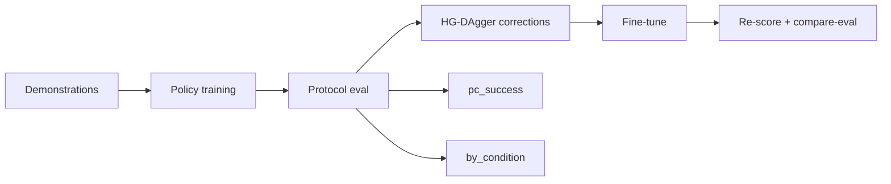

# SO-101 Visuomotor Manipulation Platform

**Author:** [romil0001](https://github.com/romil0001) · **License:** [MIT](LICENSE)

> A research platform for bimanual SO-101 manipulation: leader–follower teleoperation,
> multi-view RGB and metric wrist depth, imitation learning (ACT, SmolVLA), human-gated
> DAgger, depth-assisted hybrid grasping, and protocol-based evaluation with per-condition
> success rates.

## Abstract

We study visuomotor manipulation on a low-cost SO-101 dual-arm cell with a
**distributed sensing architecture** (Mac control + Windows depth/RGB publisher).
Human demonstrations are collected via leader teleoperation and stored in a local
episode format with synchronized proprioception and video. Policies are trained
offline (ACT with optional depth; SmolVLA with language), optionally refined with
**human-gated DAgger**, and evaluated in closed loop under a **fixed YAML protocol**
with binary success labels and condition strata. A hybrid controller delegates
contact-phase height correction to metric wrist depth while leaving approach and
place to the base policy.

## Research contributions

1. **Local visuomotor pipeline** — record, train, eval, and replay without Hub
   upload; LeRobot used as a hardware driver only.
2. **Multi-view + metric depth** — wrist D405 and overhead RGB streamed over ZMQ;
   depth optionally in ACT training and in a grasp-phase controller.
3. **Protocol-based outcomes** — repeated trials per scene condition with binary
   success labels; reports `pc_success` and per-condition breakdown instead of
   train loss.
4. **HG-DAgger** — expert corrections on policy-visited states; fine-tune without
   overwriting the baseline checkpoint; `compare-eval` for Δ`pc_success`.
5. **Hybrid depth grasp** — decouple VLA approach from analytic contact control.

## Visualizations

**Showcase (GitHub Pages):** [romil0001.github.io/SO101_Visuomotor_Manipulation](https://romil0001.github.io/SO101_Visuomotor_Manipulation/) · source [`docs/index.html`](docs/index.html)

### Real-robot observations

| Overhead (scene) | Wrist (ego) |
|:---:|:---:|
|  |  |

Task scene (photo): early keys-in-cup layout — still useful for camera framing. **Primary
task today:** *Place bag clip in bowl* on dataset `so101_bag_clip_bowl` with protocol
[`config/eval/bag_clip_in_bowl.yaml`](config/eval/bag_clip_in_bowl.yaml). Legacy
pen-to-keys eval: [`config/eval/pen_to_keys.yaml`](config/eval/pen_to_keys.yaml).

### Eval success rates (bag clip — early)

Scored ACT on the bag-clip protocol is still **early / incomplete** (runs often end
without a full grid or `summary.json`). So far: about **4 successes in ~27 trials
(~15%)** — not a finished benchmark.

| Legacy fixture charts (pen-to-keys, illustrative) | |
|:---:|:---:|
|  |  |

Regenerate plots from real `outputs/eval/.../summary.json` — see [`assets/README.md`](assets/README.md).

## System overview



## Outcome graphs

Full outcome flow, policy comparison, and eval protocol diagrams:

**→ [`docs/outcomes.md`](docs/outcomes.md)**



## Quick reproduction

```bash
git clone https://github.com/romil0001/SO101_Visuomotor_Manipulation.git
cd SO101_Visuomotor_Manipulation
bash env/setup_env.sh
# configure config/ports.env and config/camera.env — see docs/reproduction.md
bash scripts/08_record.sh
bash scripts/10_train_act.sh          # → outputs/train/act_so101_bag_clip_bowl/
bash scripts/11_eval_act.sh           # interactive: dataset, checkpoint, protocol/timed, control mode
# optional HG-DAgger:
bash scripts/18_dagger.sh
bash scripts/19_train_dagger.sh
bash scripts/20_rescore_compare.sh    # re-eval + compare-eval hints
POLICY_PATH=outputs/train/act_so101_bag_clip_bowl_dagger bash scripts/11_eval_act.sh
# optional depth assist at contact:
bash scripts/15_eval_hybrid.sh        # config/hybrid_grasp.yaml
```

Hardware setup, safety, and full command list: [`docs/reproduction.md`](docs/reproduction.md).

## Documentation

| Document | Contents |
|----------|----------|
| [`docs/algorithms.md`](docs/algorithms.md) | Setup vs ML algorithms, and how to add a policy |
| [`docs/methods.md`](docs/methods.md) | Apparatus, data schema, policies, eval protocol |
| [`docs/outcomes.md`](docs/outcomes.md) | Outcome graphs and reported metrics |
| [`docs/literature_review.md`](docs/literature_review.md) | Related work and the ML research gap this platform targets |
| [`research/`](research/README.md) | PhD-style ML research programme: proposal, pre-registration, LaTeX paper |
| [`docs/architecture.md`](docs/architecture.md) | Software module map |
| [`docs/reproduction.md`](docs/reproduction.md) | Lab setup and experiment workflow |
| [`docs/eval_logs.md`](docs/eval_logs.md) | `outputs/eval/`, `session.log`, `summary.json` |
| [`docs/checklist.md`](docs/checklist.md) | Power and labeling checklist |

## Citation

If you use this platform, please cite:

```bibtex
@software{so101_visuomotor_manipulation,
  author = {Modi, Romil},
  title = {SO-101 Visuomotor Manipulation Platform},
  year = {2026},
  url = {https://github.com/romil0001/SO101_Visuomotor_Manipulation}
}
```

Or use [`CITATION.cff`](CITATION.cff) for automatic GitHub citation metadata.

## Acknowledgments

- [Hugging Face LeRobot](https://github.com/huggingface/lerobot) — SO-101 hardware drivers
- SO-101 arm documentation: https://huggingface.co/docs/lerobot/en/so101
