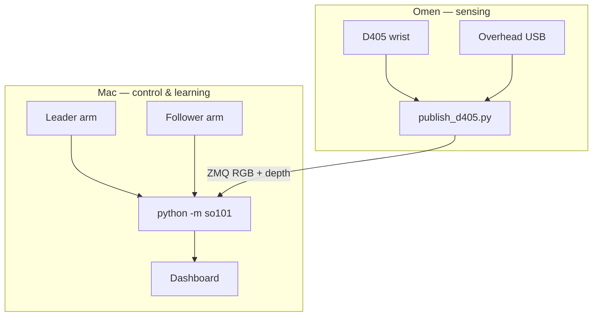
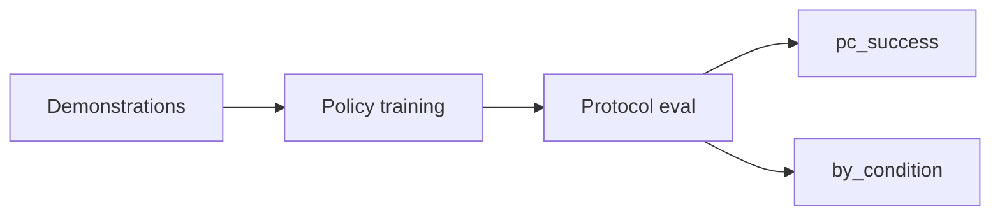

# SO-101 Visuomotor Manipulation Platform

**Author:** [romil0001](https://github.com/romil0001) · **License:** [MIT](LICENSE)

> A research platform for bimanual SO-101 manipulation: leader–follower teleoperation,
> multi-view RGB and metric wrist depth, imitation learning (ACT, SmolVLA), depth-assisted
> hybrid grasping, and protocol-based evaluation with per-condition success rates.

## Abstract

We study visuomotor manipulation on a low-cost SO-101 dual-arm cell with a
**distributed sensing architecture** (Mac control + Windows depth/RGB publisher).
Human demonstrations are collected via leader teleoperation and stored in a local
episode format with synchronized proprioception and video. Policies are trained
offline (ACT with optional depth; SmolVLA with language) and evaluated in closed
loop under a **fixed YAML protocol** with binary success labels and condition
strata. A hybrid controller delegates contact-phase height correction to metric
wrist depth while leaving approach and place to the base policy.

## Research contributions

1. **Local visuomotor pipeline** — record, train, eval, and replay without Hub
   upload; LeRobot used as a hardware driver only.
2. **Multi-view + metric depth** — wrist D405 and overhead RGB streamed over ZMQ;
   depth optionally in ACT training and in a grasp-phase controller.
3. **Protocol-based outcomes** — GDM-style eval grid (`pc_success`, `by_condition`);
   train loss is not treated as a manipulation metric.
4. **Hybrid depth grasp** — decouple VLA approach from analytic contact control.

## System overview



## Outcome graphs

Full outcome flow, policy comparison, and eval protocol diagrams:

**→ [`docs/outcomes.md`](docs/outcomes.md)**



## Quick reproduction

```bash
git clone https://github.com/romil0001/SO101_Visuomotor_Manipulation.git
cd SO101_Visuomotor_Manipulation
bash env/setup_env.sh
# configure config/ports.env and config/camera.env — see docs/reproduction.md
bash scripts/08_record.sh
bash scripts/10_train_act.sh
bash scripts/11_eval_act.sh   # → outputs/eval/.../summary.json
```

Hardware setup, safety, and full command list: [`docs/reproduction.md`](docs/reproduction.md).

## Documentation

| Document | Contents |
|----------|----------|
| [`docs/methods.md`](docs/methods.md) | Apparatus, data schema, policies, eval protocol |
| [`docs/outcomes.md`](docs/outcomes.md) | Outcome graphs and reported metrics |
| [`docs/architecture.md`](docs/architecture.md) | Software module map |
| [`docs/reproduction.md`](docs/reproduction.md) | Lab setup and experiment workflow |
| [`docs/checklist.md`](docs/checklist.md) | Power and labeling checklist |

## Citation

If you use this platform, please cite:

```bibtex
@software{so101_visuomotor_manipulation,
  author = {Modi, Romil},
  title = {SO-101 Visuomotor Manipulation Platform},
  year = {2026},
  url = {https://github.com/romil0001/SO101_Visuomotor_Manipulation}
}
```

Or use [`CITATION.cff`](CITATION.cff) for automatic GitHub citation metadata.

## Acknowledgments

- [Hugging Face LeRobot](https://github.com/huggingface/lerobot) — SO-101 hardware drivers
- SO-101 arm documentation: https://huggingface.co/docs/lerobot/en/so101
