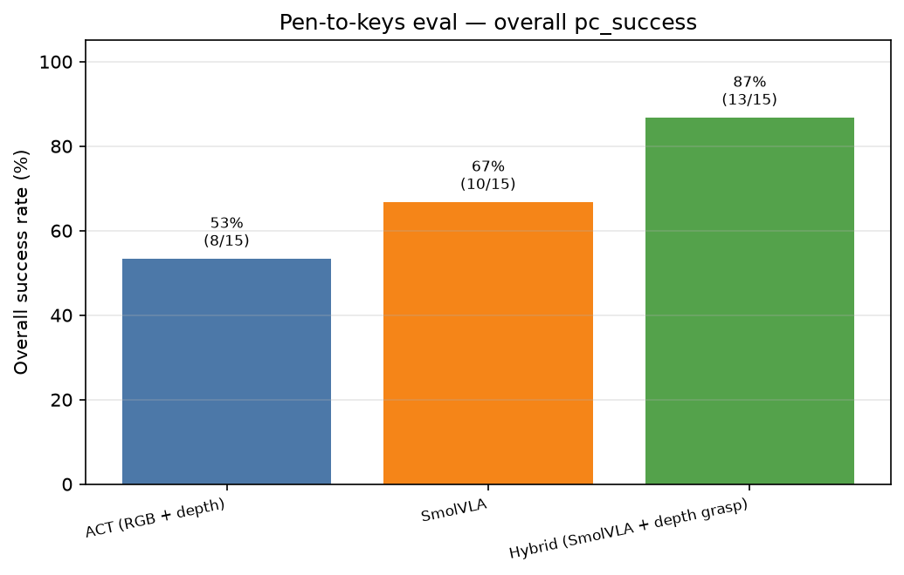
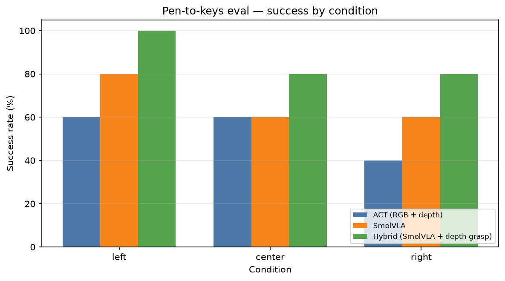
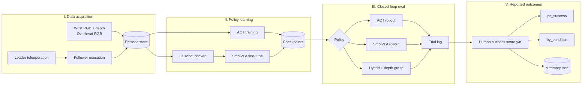
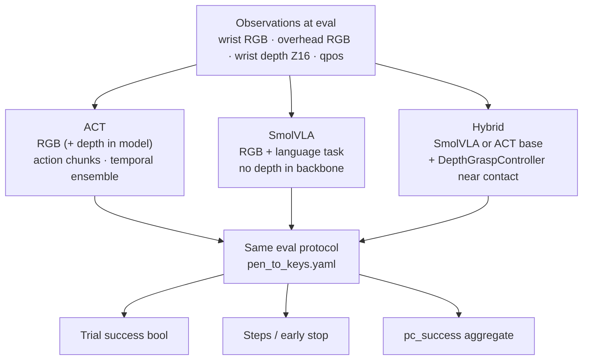
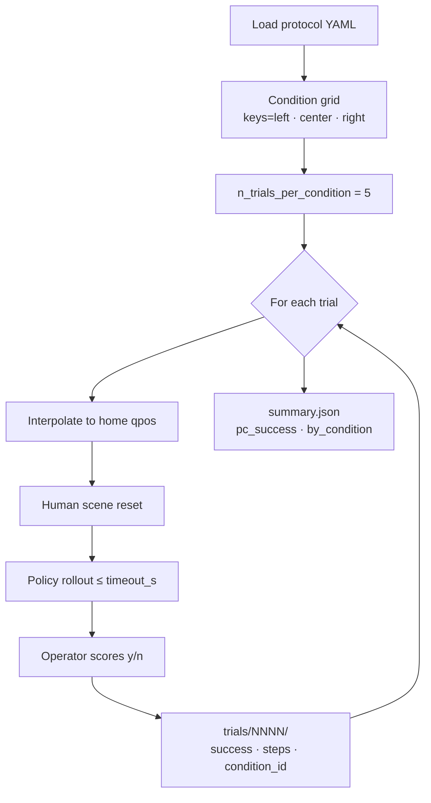
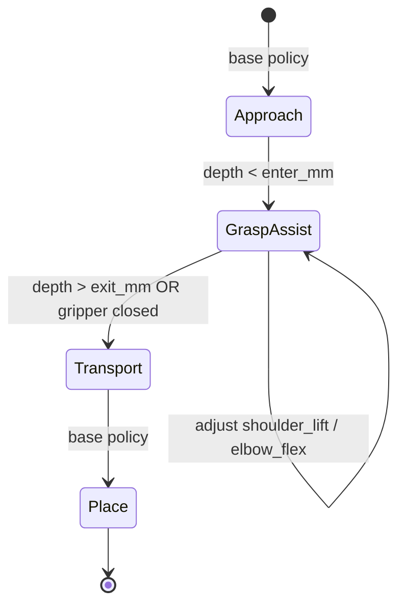

# Research outcomes and evaluation graphs

This document maps **measurable outcomes** produced by the platform and how they
flow from data collection to reported metrics. See [`methods.md`](methods.md) for
methodological detail and [`reproduction.md`](reproduction.md) for hardware setup.

## Primary research outcomes

| Outcome | Definition | Where stored |
|---------|------------|--------------|
| **Demonstration corpus** | Teleoperated episodes with synchronized proprioception and video (+ optional depth) | `data/datasets/<name>/` |
| **Imitation policy** | ACT or fine-tuned SmolVLA checkpoint | `outputs/train/` |
| **Autonomous rollout** | Closed-loop follower execution under a loaded policy | `outputs/eval/<checkpoint>/<run_id>/trials/` |
| **Success rate** | Fraction of trials scored successful under a fixed protocol | `summary.json` → `pc_success` |
| **Per-condition breakdown** | Success rate stratified by manipulation condition (e.g. object layout) | `summary.json` → `by_condition` |

Train loss (`metrics.jsonl`) is a **training diagnostic**, not a reported outcome.
Reported manipulation performance uses **protocol eval** only.

Outcome graphs (mermaid): below. **Committed result plots:** [`assets/graphs/`](../assets/graphs/).





## End-to-end outcome flow



## Policy comparison graph

Three policy families share the same eval harness and protocol; they differ in
observation modality and contact-phase control.



**Hypothesis the hybrid stack tests:** language-driven visuomotor policies handle
approach and transport; metric wrist depth improves contact-phase height and
grasp reliability without feeding depth into the VLA backbone.

## Evaluation protocol graph

Default task: *Place keys into metal cup*. Protocol:
`config/eval/pen_to_keys.yaml`.



### Success criterion (fixed at eval time)

Keys inside the metal cup, gripper clear of the keys, nothing knocked over.
Each trial is scored independently after a fresh reset, so success rates reflect
real task completion and can be compared fairly across policies and conditions.

### Example outcome structure

After `python -m so101 eval --protocol config/eval/pen_to_keys.yaml`:

```text
outputs/eval/<checkpoint>/<run_id>/
  protocol.json      # frozen protocol + checkpoint metadata
  summary.json       # pc_success, by_condition, trial counts
  trials/0001/
    trial.json       # success, steps, condition_id, early_stop
  trials/0002/
    ...
```

`summary.json` fields used in papers/reports:

- `pc_success` — overall success rate in [0, 1]
- `by_condition` — map from condition id → `{successes, trials, rate}`
- `n_trials` — total scored trials

## Depth-assisted grasp outcome

Hybrid eval adds a **contact-phase sub-outcome**: whether depth-based vertical
correction reduced grasp height error before lift.



Tune thresholds in `config/hybrid_grasp.yaml`. Logged trial metrics still use
the same binary task success; depth grasp is an **intervention**, not a separate
score, unless you add ablation conditions to the protocol YAML.

## Suggested reporting table (thesis / paper)

| Method | Observations | Contact phase | Metric |
|--------|--------------|---------------|--------|
| ACT | RGB (+ depth optional) | learned end-to-end | `pc_success`, `by_condition` |
| SmolVLA | RGB + language | learned end-to-end | same |
| Hybrid (SmolVLA + depth) | RGB + language; depth at grasp only | analytic depth controller | same |
| Hybrid (ACT + depth) | RGB + depth; depth at grasp only | analytic depth controller | same |

Hold camera config, task string, and protocol YAML constant across rows.
